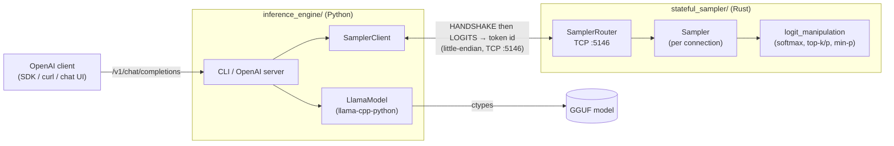
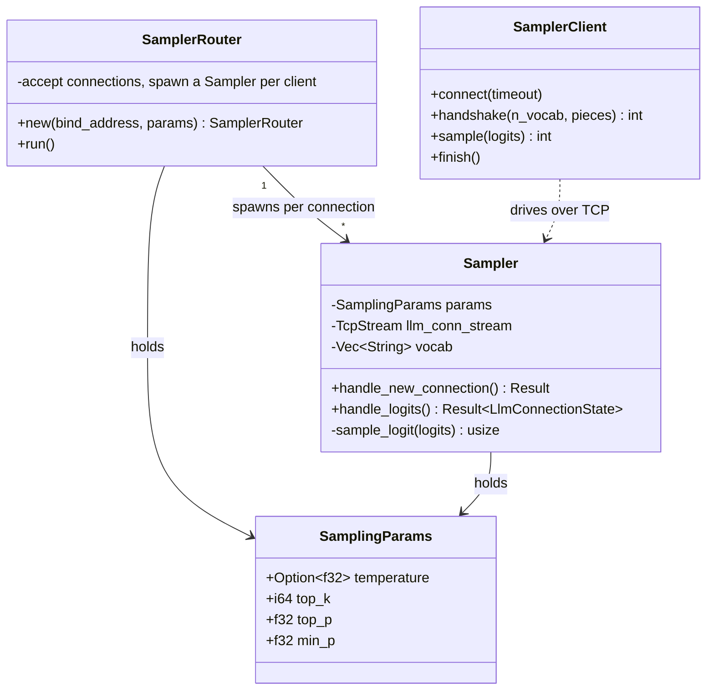

# Architecture

The inference engine owns the model and the decode loop. The sampler owns the
sampling policy. They meet over one TCP connection that carries the
[wire protocol](wire-protocol.md).



Each component page has its own diagrams:
[Inference engine](components/inference-engine.md#architecture),
[Stateful sampler](components/stateful-sampler.md),
[Prompt eval](components/prompt-eval.md#architecture).

## Component responsibilities



!!! note "Single instance only"
    The Rust sampler assumes **one** engine and **one** active chat completion at a
    time. There is no per-request context id, so concurrent chats / branched
    generations are not supported. See the sampler's
    [design assumptions](components/stateful-sampler.md#design-assumptions).

## Repository layout

```
.
├── docs/                 # This documentation site (Markdown pages, MkDocs)
├── inference_engine/     # Python: llama.cpp runner + OpenAI-compatible server
│   ├── tcpip_gen/        #   protocol, client, generation, engine, server, CLI
│   └── tests/
├── stateful_sampler/     # Rust: TCP sampler server
│   └── src/
│       ├── main.rs       #   CLI args + SamplerRouter bootstrap
│       └── sampler/      #   Sampler + logit_manipulation
├── prompt_eval/          # Python: benchmark prompt bags for the chat endpoint
│   ├── fetch_prompts.py  #   downloads bags from Hugging Face
│   ├── run_bag.py        #   feeds a bag to the endpoint, stores JSONL responses
│   └── bags/             #   stored prompt bags (JSON)
├── docker-compose.yml    # Full environment: sampler + engine + Open WebUI
├── mkdocs.yml            # Docs site: left-panel nav and Markdown extensions
└── README.md             # Entry point on GitHub; links into docs/
```
