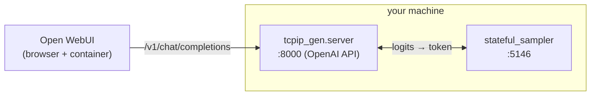

# Open WebUI

[Open WebUI](https://github.com/open-webui/open-webui) can drive the inference
engine through its OpenAI-compatible server. The server also answers Open WebUI's
Ollama-style probes (`/api/version`, `/api/tags`, `/api/ps`, and their `/v1/...`
aliases), so it shows up as a working connection.

[Docker Compose](docker-compose.md) starts Open WebUI already wired to the
engine. The steps below run it by hand against a server started from source.



## 1. Start the sampler and the OpenAI server

The server must be reachable from the Open WebUI container, so bind it to
`0.0.0.0` (not the default `127.0.0.1`). `--model-id` sets the name shown in Open
WebUI's model picker.

```bash
# Terminal 1 — Rust sampler
cd stateful_sampler
cargo run

# Terminal 2 — OpenAI-compatible server, reachable from containers
cd inference_engine
uv run python -m tcpip_gen.server \
    --model <model.gguf> \
    --host 0.0.0.0 --port 8000 \
    --sampler-host 127.0.0.1 --sampler-port 5146 \
    --model-id local-llama \
    --max-tokens 256
```

## 2. Run Open WebUI

```bash
docker run -d --name open-webui -p 3000:8080 \
    --add-host=host.docker.internal:host-gateway \
    -e OPENAI_API_BASE_URL=http://host.docker.internal:8000/v1 \
    -e OPENAI_API_KEY=sk-ignored \
    -v open-webui:/app/backend/data \
    ghcr.io/open-webui/open-webui:main
```

- `host.docker.internal` lets the container reach the server running on the host.
  On Linux the `--add-host=...:host-gateway` flag wires this up (it already works
  on Docker Desktop for macOS/Windows).
- The API key is accepted and ignored by the server, but Open WebUI requires a
  non-empty value.

Then open <http://localhost:3000>, and the `local-llama` model is available in
the chat model selector.

## Configuring the connection in the UI instead

If you skip the `OPENAI_API_BASE_URL` env var, add the connection from the web UI:
**Settings → Admin Settings → Connections → OpenAI API**, set the base URL to
`http://host.docker.internal:8000/v1` and any non-empty API key, then save.

!!! note
    Sampling controls in Open WebUI (temperature, top-p, …) are **ignored**. The
    [wire protocol](../wire-protocol.md) only carries logits, so sampling is
    governed by the Rust sampler's flags. Adjust them via
    `cargo run -- --temperature … --top-k …` on the sampler.
    Only one chat completion runs at a time (see the
    [single-instance assumption](../components/stateful-sampler.md#design-assumptions)),
    so avoid concurrent generations across multiple Open WebUI chats.
