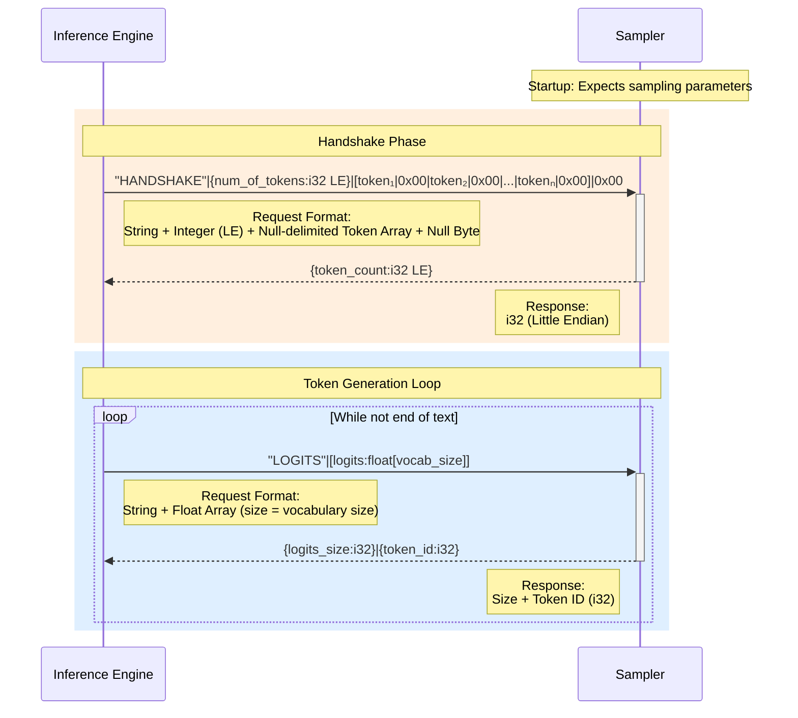

# Wire protocol

The engine and the sampler exchange a one-time **handshake** (vocabulary
exchange) followed by a **per-token** loop. All integers and floats are
**little-endian**. The engine frames messages in `tcpip_gen/protocol.py`
([Inference engine](components/inference-engine.md)); the sampler parses them in
`src/sampler.rs` ([Stateful sampler](components/stateful-sampler.md)).

| Phase     | Engine → Sampler                                                       | Sampler → Engine                       |
|-----------|------------------------------------------------------------------------|----------------------------------------|
| Handshake | `"HANDSHAKE"` + `i32(n_vocab)` + `(piece + \x00) × n_vocab` + `\x00`    | `i32(n_vocab)` (4 bytes)               |
| Per token | `"LOGITS"` + `n_vocab × f32`                                            | `i32(count)` + `i32(token)` (8 bytes)  |
| End       | socket close on end-of-generation                                      | (read == 0 ⇒ "Completed")              |

The CLI (`python -m tcpip_gen`) sends a single `\x00` (`SamplerClient.finish()`)
before it closes the socket. The HTTP server keeps one connection open across
requests and never sends that byte, because it would desync the sampler's
fixed-length framing. See
[Sampling parameters are ignored](components/inference-engine.md#sampling-parameters-are-ignored).

## Sequence

